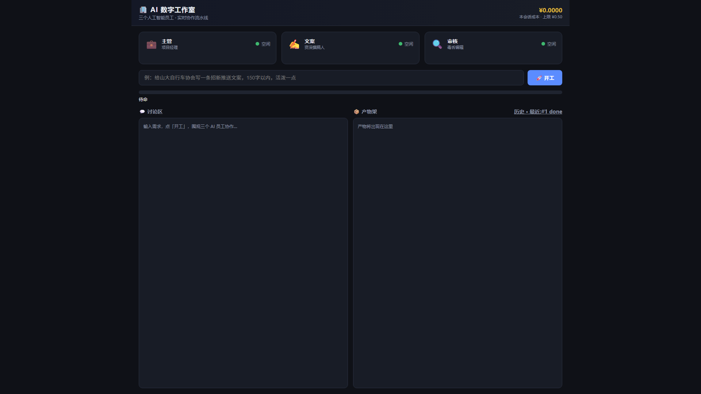

# 🏢 AI 数字工作室（ai-studio）· MVP 48小时版

> **一个人开了一家公司，员工全是 AI —— 主管💼 / 文案✍️ / 审核🔍。**

打开浏览器就是"AI 办公室"：输入一句需求 → 点「开工」→ **实时围观**三位 AI 员工派活、写稿、审核打回、重写、通过，最后产物落架。全程 SSE 流式推送，顶部进度条 + 实时成本显示。

---

## ✨ 演示效果



> 上面这张是**真实跑通流水线后**的界面：三工位卡片、讨论区实况、产物架成品文件一目了然。

### 一图看懂流水线

```
老板说一句需求（如"给山大车协写招新文案"）
        │
        ▼
┌─────────────┐    原样转发    ┌─────────────┐
│  主管 💼     │ ────────────▶ │   文案 ✍️    │
│  项目经理    │              │  资深撰稿人   │
└─────────────┘              └──────┬──────┘
        ▲                           │ 初稿(流式)
        │ 主管总结                   ▼
┌─────────────┐              ┌─────────────┐
│  产物架 📦   │◀── 通过 ─────│   审核 🔍    │
│  成品落架    │              │  毒舌编辑    │
└─────────────┘              └──────┬──────┘
                                    │ 打分
                           < 80 打回(最多2次) ──▶ 文案重写
                           ≥ 80 通过(第3次强制通过=带伤交付) ──▶ 主管总结 → 产物落架
```

**关键机制**
- **驳回循环硬上限 2 次**：第 3 次打回强制通过，标注「带伤交付」——防 token 失控。
- **预算熔断**：每次调用后按官方单价累计成本，超 `max_cost_cny`（默认 0.5 元）立即中断并红色提示。
- **审核打杂用便宜模型**：审核走 `deepseek-v4.1-flash` 便宜通道，主管/文案走 `deepseek-chat`，真正的成本控制。

---

## 🚀 快速开始

```bat
cd D:\ai-studio
start.bat
```

或

```bat
python -m uvicorn app:app --port 8600
```

浏览器自动打开 `http://127.0.0.1:8600`。输入一句需求，点「开工」，围观三位 AI 员工实时协作。

> **模型 key**：运行时只读加载自 `D:\deepseek ha\config.json`（`deepseek_key`/`deepseek_base`/`model`，以及 `nachoneko_*` 便宜模型）。本仓库**不复制、不存储任何 key**。

---

## 📁 目录结构

```
D:\ai-studio\
├── app.py            # FastAPI：页面 / api/task / stream SSE / 产物下载
├── orchestrator.py   # 编排器：状态机 draft→review→revise(≤2)→final；预算熔断；SSE 广播
├── agents.py         # Agent 基类 + 三角色；DeepSeek/nachoneko 流式调用；重试+退避+降级
├── store.py          # SQLite：会话/消息/产物索引；artifacts\ 存成品
├── static/index.html # 单页前端：原生 JS + EventSource，零构建
├── agents.json       # 三角色固定角色设定（主管=项目经理 / 文案=撰稿人 / 审核=毒舌编辑）
├── config.json       # port / 预算上限 / 驳回上限 / 模型选择（不含 key）
├── pricing.json      # DeepSeek 官方单价估算（元/千token）
├── start.bat         # 一键启动 + 自动开浏览器
├── docs\             # 界面截图
└── README.md         # 本文件
```

**运行时生成**（非交付内容）：`studio.db`（历史会话）、`artifacts\产出_*.md`（成果物）。

---

## ✅ 验收自测结果（对照交接文档第 6 节）

| # | 验收项 | 结果 |
|---|---|---|
| 1 | `grep -r "sk-"` 无 key 泄露；config.json 不含 key | ✅ 全仓库无 `sk-`，外部 config 仅只读 |
| 2 | 启动自动开浏览器；三工位卡片渲染 | ✅ `open_browser` + 页面三卡验证 |
| 3 | 完整时间线（派活→初稿→打回→重写→通过→总结→落架） | ✅ 真实 DeepSeek API 端到端跑通 |
| 4 | 驳回第 3 次强制通过 + 带伤交付 | ✅ 状态机测试 reject×2→pass(带伤) |
| 5 | 进度条阶段 + 成本随调用更新 | ✅ `cost` 事件逐次累计，实测 0.006~0.014 元 |
| 6 | 断网/拔 key 明确报错，无假进度 | ✅ `ProviderUnavailable`→红字 error |
| 7 | 刷新后历史会话仍在 | ✅ SQLite 持久化，消息+产物索引 |
| 8 | 1366×768 与 1920×1080 不变形 | ✅ 两分辨率 headless 截图验证 |
| 9 | README 含 2 截图位 + Roadmap | ✅ `docs/` 截图 + Roadmap 清单 |

**实测单次成本**：完整流水线约 **¥0.006~0.009**（一次打回场景）～ **¥0.013**（满 2 次驳回），远低于 ¥0.5 预算上限。

---

## 🗺️ Roadmap（砍掉的功能，MVP 不做）

- **自动任务拆解**：主管收到需求自动分解子任务（MVP 里原样转发 + 一句话验收标准）。
- **多任务并行**：多个需求同时跑、多人协作。
- **多模型路由**：按任务类型自动选模型 / 按成本权重分配。
- **用户系统**：登录、会话归属、权限。
- **部署上线**：云端多进程、鉴权、HTTPS。
- **人设/人格系统**：接入自定义 persona（MVP 用固定角色，不碰外部人格配置）。
- **更精细成本优化**：缓存、上下文裁剪、token 预算分摊。

---

## 🛡️ 约束自检摘要

- ✅ key 绝不写入本仓库（运行时只读加载外部 config，全程无写回）。
- ✅ 驳回循环硬上限 2 次，第 3 次强制通过并标注「带伤交付」。
- ✅ 预算硬上限 `max_cost_cny`（默认 0.5 元），超限立即熔断报红。
- ✅ 主管不拆任务（需求原样转发 + 验收标准）。
- ✅ 三角色用 `agents.json` 固定角色，不复用外部 persona。
- ✅ 一切失败可降级：重试 2 次 → 失败中止并保留已完成部分 + 页面明确报错（不假装在跑）。
- ✅ 砍掉一切 Roadmap 外功能，仅交付"单需求→三 Agent→最多 2 次驳回→出成品"一条流水线。

---

*AI 数字工作室 · MVP · 交付版*